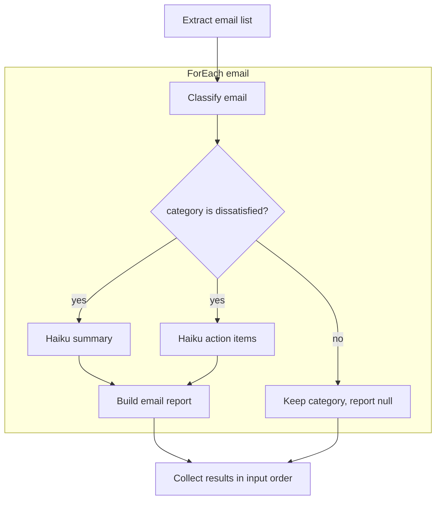

# liteflow

code-first workflows for the LiteLLM AI Gateway

write your workflow in Python, run it on your gateway, and read the result.

## Features

- LLM calls with standard Chat Completions arguments
- Python functions with typed inputs and outputs
- structured JSON from Pydantic schemas
- sequential, parallel, conditional and per-item workflow definitions
- one client to register, run, and inspect workflows

## Installation

install from a source checkout:

```sh
python -m pip install -e .
```

gateway execution requires the [workflow runner](https://github.com/BerriAI/litellm/pull/50376) and [Python execution adapter](https://github.com/BerriAI/litellm/pull/50327). graph authoring in this branch compiles locally; the gateway graph runner is still in development. the sequential runner does not execute graph definitions.

## Usage

process a batch of customer emails. classify each email, then send dissatisfied emails to Haiku for a summary and action items in parallel. return one report per dissatisfied email and keep the category for the others.



this example defines sequential steps, a per-item loop, a JSON-field condition and parallel branches in one workflow. copy the complete definition below, or use [the same example file](examples/email_processing_graph.py).

```python
from typing import Literal

from pydantic import BaseModel

from liteflow import (
    ChatCompletion,
    ChatMessage,
    ForEach,
    If,
    Input,
    Parallel,
    Python,
    Retry,
    Workflow,
)

Category = Literal["feedback", "dissatisfied", "happy"]


class Emails(BaseModel):
    items: list[str]


class Classification(BaseModel):
    category: Category


class Actions(BaseModel):
    action_items: list[str]


class EmailResult(BaseModel):
    email: str
    category: Category
    report: str | None


def prompt(email: str, instruction: str) -> list[ChatMessage]:
    return [{"role": "system", "content": instruction}, {"role": "user", "content": email}]


def is_dissatisfied(result: Classification) -> bool:
    return result.category == "dissatisfied"


def make_report(email: str, summary: str, actions: Actions) -> EmailResult:
    report = summary + "\n\nAction items:\n" + "\n".join(actions.action_items)
    return EmailResult(email=email, category="dissatisfied", report=report)


def no_report(email: str, classification: Classification) -> EmailResult:
    return EmailResult(email=email, category=classification.category, report=None)


def haiku_analysis(instruction: str, response_model: type[BaseModel] | None = None) -> list[Python | ChatCompletion]:
    return [
        Python(fn=prompt, inputs={"email": Input.item, "instruction": instruction}),
        ChatCompletion(model="haiku", messages=Input.previous, response_model=response_model, timeout_seconds=30),
    ]


workflow = Workflow(
    name="email-processing",
    nodes=[
        ChatCompletion(model="support-model", messages=Input.messages, response_model=Emails),
        ForEach(
            items=Input.previous.field("items"),
            max_items=100,
            max_concurrency=4,
            nodes=[
                Python(
                    fn=prompt,
                    inputs={"email": Input.item, "instruction": "Classify as feedback, dissatisfied, or happy."},
                ),
                ChatCompletion(
                    model="support-model",
                    messages=Input.previous,
                    response_model=Classification,
                    timeout_seconds=35,
                    retry=Retry(max_attempts=2, backoff_seconds=1),
                ),
                If(
                    condition=is_dissatisfied,
                    then=[
                        Parallel(
                            max_concurrency=2,
                            branches={
                                "summary": haiku_analysis("Summarize this customer complaint."),
                                "actions": haiku_analysis("List action items for this complaint.", Actions),
                            },
                        ),
                        Python(
                            fn=make_report,
                            inputs={
                                "email": Input.item,
                                "summary": Input.previous.field("summary"),
                                "actions": Input.previous.field("actions"),
                            },
                        ),
                    ],
                    otherwise=[Python(fn=no_report, inputs={"email": Input.item, "classification": Input.previous})],
                ),
            ],
        ),
    ],
)
```

`is_dissatisfied` checks the model's structured `category` field. only its `then` branch defines the Haiku analyses. `haiku_analysis` builds a prompt node and a completion node; it runs on your client when you define the workflow.

`Input.item` keeps the original email available after classification and parallel analysis. `Input.previous.field("summary")` and `.field("actions")` select the two branch outputs. both conditional exits return `EmailResult`; the loop returns `list[EmailResult]` in input order.

### Register and run

replace `support-model` and `haiku` with configured gateway model aliases. set `LITELLM_PROXY_URL` to the gateway root URL without `/v1`, and keep the key in `LITELLM_PROXY_API_KEY`. use a key with the required workflow access.

**execution requires the gateway graph runner, which is still in development. you can compile this definition locally today; the sequential gateway runner does not execute it.**

on a gateway with graph support, register the definition:

```python
import os

from liteflow import GatewayClient

gateway = GatewayClient(
    base_url=os.environ["LITELLM_PROXY_URL"],
    api_key=os.environ["LITELLM_PROXY_API_KEY"],
)
draft = gateway.register(workflow)
```

ask a separate authorized reviewer to publish the draft. then invoke it with the same client:

```python
result = gateway.run(
    workflow.name,
    messages=[
        {"role": "system", "content": "Extract each email from the supplied batch into items."},
        {"role": "user", "content": "Email 1: My refund is three weeks late.\nEmail 2: Thanks for your help!"},
    ],
)
print(result.output)
print(result.run_id)
gateway.close()
```

`run()` invokes `/v1/chat/completions` with `model="workflow/email-processing"`. the final content is a JSON array containing each email, its category and its report. feedback and happy emails have `report: null`. use `result.run_id` to inspect node inputs, outputs and timing on the gateway; publish a new draft after changing the definition.

## Workflow patterns

keep nodes in a list. put another workflow pattern inside that list when you need branches or per-item work:

| Pattern | Definition | Output passed to the next node |
| --- | --- | --- |
| Sequential | `Workflow(nodes=[...])` | the last node's result |
| Nested sequence | `Sequence(nodes=[...])` | the last child result |
| Parallel | `Parallel(branches={"summary": [...], "risk": [...]})` | an object keyed by branch name |
| Per-item loop | `ForEach(items=Input.previous.field("items"), nodes=[...])` | results in the original item order |
| Conditional | `If(condition=needs_review, then=[...], otherwise=[...])` | the selected branch's result |

combine these patterns to build a hybrid workflow. you use the same `gateway.register(workflow)` and `gateway.run(workflow.name, messages=...)` calls for each pattern.

full examples with typed functions and model responses:

- [email feedback](examples/email_feedback.py): classify an email as feedback, dissatisfied or happy; send dissatisfied emails to Haiku for a summary, action items and a report
- [batch email analysis](examples/batch_email_analysis.py): extract a list, process each email, run parallel analyses, and combine the results into a report
- [spreadsheet classification](examples/spreadsheet_classification.py): classify one row and apply a Python review threshold

## Inputs and outputs

use `response_model=YourPydanticModel` for structured LLM output. Python function annotations define the next step's input and output contracts.

- `Input.messages`: the original invocation messages
- `Input.previous`: the previous node's result; a branch starts with its parent's incoming value
- `Input.previous.field("items")`: a field from a structured result
- `Input.item`: the original item inside the nearest `ForEach`, even after another node changes `Input.previous`

a Python function with one argument receives `Input.previous`. use `inputs={...}` when it needs several values, such as the classification and original email. you do not repeat input/output schemas in the node definition.

set `max_items` and `max_concurrency` on `ForEach`; set `max_concurrency` on `Parallel`. both `If` exits return the same output contract. see [graph workflows](docs/graph-workflows.md) for definitions, limits and nesting.

leaf calls keep their existing timeout and retry settings:

```python
from liteflow import Retry

ChatCompletion(
    model="support-model",
    messages=Input.messages,
    timeout_seconds=40,
    retry=Retry(max_attempts=2, backoff_seconds=1),
)
```

the timeout covers the node's attempts and backoff. per-node fallback model aliases are a separate gateway follow-up.

## About

use liteflow for work you can define in advance: process an email, classify a spreadsheet row, or route a request for review.

see the [gateway API](docs/gateway-api.md), [Python execution contract](docs/execution.md), and [implementation plan](docs/implementation-plan.md).

## License

[MIT](LICENSE)

## Contributing

open an issue or pull request. start with the [workflow examples](examples/) and [implementation plan](docs/implementation-plan.md).

