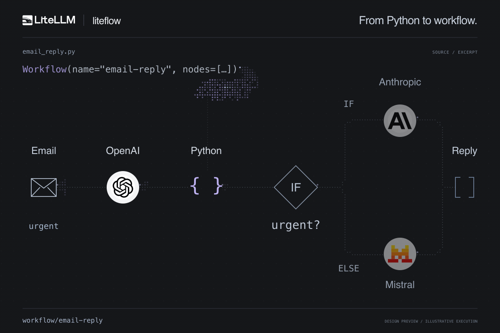

# liteflow

code-first workflows for the LiteLLM AI Gateway



chain LLM calls and typed Python functions. each node passes its result to the next:

```python
from liteflow import ChatCompletion, ChatMessage, Input, Python, Workflow


def review_messages(draft: str) -> list[ChatMessage]:
    return [{"role": "user", "content": "Review and improve this reply: " + draft}]


workflow = Workflow(name="email-reply", nodes=[
    ChatCompletion(model="sonnet", messages=Input.messages),
    Python(fn=review_messages),
    ChatCompletion(model="haiku", messages=Input.previous),
])
```

Sonnet drafts a reply. Python turns that draft into review messages. Haiku reads those messages and returns the final reply.

## Register and run

install from a source checkout with `python -m pip install -e .`. replace `sonnet` and `haiku` with your gateway's model aliases.

set `LITELLM_PROXY_URL` to your gateway root URL without `/v1`, and keep your key in `LITELLM_PROXY_API_KEY`. register the workflow:

```python
import os

from liteflow import GatewayClient

gateway = GatewayClient(
    base_url=os.environ["LITELLM_PROXY_URL"],
    api_key=os.environ["LITELLM_PROXY_API_KEY"],
)
draft = gateway.register(workflow)
```

ask a separate authorized reviewer to publish the draft. then run it and read the result:

```python
result = gateway.run(workflow.name, messages=[
    {"role": "system", "content": "Write a short customer-service reply."},
    {"role": "user", "content": "How can I update my account email?"},
])
print(result.output)
gateway.close()
```

`run()` uses Chat Completions with `model="workflow/email-reply"`. `Input.messages` is the original request; `Input.previous` is the previous node's result. use `result.run_id` to inspect the run.

## Advanced workflows

graph definitions compile locally; gateway graph execution is still in development.

### Parallel

ask two models the same question:

```python
from liteflow import ChatCompletion, Input, Parallel, Workflow

workflow = Workflow(name="compare-models", nodes=[
    Parallel(branches={
        "sonnet": [ChatCompletion(model="sonnet", messages=Input.messages)],
        "haiku": [ChatCompletion(model="haiku", messages=Input.messages)],
    }),
])
```

the result contains one response per branch.

### Loop

summarize each email in a batch:

```python
from liteflow import ChatCompletion, ForEach, Input, Workflow

workflow = Workflow(name="email-summaries", nodes=[
    ForEach(items=[
        [{"role": "user", "content": "Summarize: My refund is late."}],
        [{"role": "user", "content": "Summarize: Thanks for your help!"}],
    ], nodes=[
        ChatCompletion(model="haiku", messages=Input.item),
    ]),
])
```

`Input.item` is the current message batch. results keep the input order. `items` can also reference a list from an earlier node.

### Conditional

use a structured decision to choose which model handles the request:

```python
from pydantic import BaseModel
from liteflow import ChatCompletion, If, Input, Workflow

class Decision(BaseModel):
    needs_review: bool

def needs_review(result: Decision) -> bool:
    return result.needs_review

workflow = Workflow(name="route-request", nodes=[
    ChatCompletion(model="haiku", messages=Input.messages, response_model=Decision),
    If(condition=needs_review,
       then=[ChatCompletion(model="sonnet", messages=Input.messages)],
       otherwise=[ChatCompletion(model="haiku", messages=Input.messages)]),
])
```

### Hybrid

run models in parallel, then combine their answers in a Python step:

```python
from liteflow import ChatCompletion, Input, Parallel, Python, Workflow

def combine(answers: dict[str, str]) -> str:
    return "\n\n".join(answers.values())

workflow = Workflow(name="combined-answers", nodes=[
    Parallel(branches={
        "sonnet": [ChatCompletion(model="sonnet", messages=Input.messages)],
        "haiku": [ChatCompletion(model="haiku", messages=Input.messages)],
    }),
    Python(fn=combine),
])
```

register and run any of these with the same client shown above. see [graph workflows](docs/graph-workflows.md) for input bindings and limits.

## About

use liteflow for work you can define in advance: process an email, classify a spreadsheet row, or route a request for review.

see the [gateway API](docs/gateway-api.md), [Python execution contract](docs/execution.md), and [implementation plan](docs/implementation-plan.md).

## License

[MIT](LICENSE)

## Contributing

open an issue or pull request. start with the [workflow examples](examples/) and [implementation plan](docs/implementation-plan.md).
