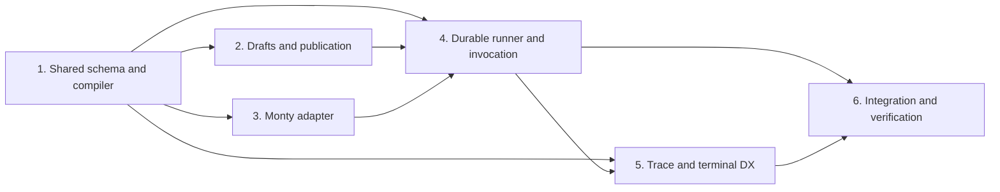

# Implementation plan

Status: proposed work allocation. This repository contains design examples and contracts; it does not contain an implemented Liteflow SDK, gateway executor, or release package.

Build one complete path first: define typed nodes, register a draft, publish it through a separate authorized publisher, and invoke it through standard Chat Completions. The first executed workflow calls an LLM, transforms its typed result in Monty, then calls an LLM with the generated messages. Extend that path to the email flow with three parallel LLM calls and three sequential LLM calls.

The first delivery checkpoint is a real client-defined, client-invoked run. A standalone schema, document, or runtime probe does not meet that checkpoint.

Use the [gateway API scope](gateway-api.md) and [execution contract](execution.md) as the starting contracts. Freeze the shared definition and execution-event schemas before owners implement incompatible variants. Changes that affect a consumer need a contract update and an acceptance example.

## End-to-end milestones

### First milestone: model to Python to model

Use a workflow with three stages:

1. A completion reads `Input.messages` and produces a typed result.
2. A top-level Python function consumes that result and returns `list[ChatMessage]`.
3. A completion uses `messages=Input.previous` and produces the final assistant response.

Required evidence: use the client to define and register this workflow, validate it, demonstrate blocked self-publication and successful independent publication, invoke it from the client through Chat Completions, and inspect one run containing the real child calls and Monty result. The server must execute the client-supplied definition rather than a predefined server example. Verify the request/result schema, exact execution order, policy enforcement, and child-only billing. No in-process mock SDK or manually fabricated trace counts as this milestone.

This milestone needs workstreams 1 through 4 and a minimal run-inspection path from 5. Workstream 6 captures the deployment and verification evidence. Expanded terminal rendering can follow the working API path.

### Second milestone: parallel email processing

Extend the same invocation path to three independent LLM calls followed by three sequential LLM calls. Use `Parallel(branches={"urgency": [...], "intent": [...], "sentiment": [...]})`, then typed Python glue and three ordered calls to draft, review, and finalize a reply. Python transformations can prepare messages between those calls; they do not count toward the six LLM calls. Preserve the original email through explicit bindings where a stage needs it. Add a separate conditional case that proves both selected outcomes while skipping the other branch.

Required evidence: capture overlapping call intervals, the all-required join, sequential stage order, a failed node retry that preserves completed siblings, typed condition input/output, per-stage deadlines, restart recovery, and an isolated replay. Use generic fixture messages and a controlled provider for failure/timing evidence.

## Workstreams and dependencies

Assign an owner to each workstream. The table describes roles, dependencies, and acceptance boundaries.

| Workstream | Owner role | Can start with | Needs before end-to-end acceptance |
| --- | --- | --- | --- |
| 1. Typed SDK, compiler, and shared schema | SDK/compiler owner | Existing examples and contract review | Agreement on supported annotations, references, and node/result envelopes |
| 2. Draft storage, publication, and permissions | Gateway management owner | Definition schema outline and existing run tracking | Stable definition schema and identity/permission contract from 1 |
| 3. Monty adapter and worker packaging | Execution-runtime owner | Execution contract and local runtime probe | Function bundle and record representation from 1 |
| 4. Durable execution and invocation | Gateway execution owner | Interfaces from 1; controlled provider and runtime doubles | Published snapshots from 2 and tested Monty adapter from 3 |
| 5. Traces, replay, cancellation, and terminal DX | Developer-tools owner | Event/step schema agreement with 1 and 4 | Live run/step endpoints and execution controls from 4 |
| 6. Self-host integration and release verification | Integration/verification owner | Release footprint and acceptance-case design | Packaged SDK, gateway, and worker artifacts from 1 through 5 |

Owners can develop against agreed interfaces in parallel. Doubles help isolate their work; they do not count as proof that a live workflow runs.

## 1. Typed SDK, compiler, and shared schema

Deliver:

- Public authoring types for `Workflow(nodes=[...])`, `ChatCompletion`, `Python`, `If`, and explicit `Parallel(branches={name: [nodes...]})` groups, plus the client path to register and invoke their compiled definitions.
- Direct completion fields, `Input.messages` for the original request, and `Input.previous` for the current sequence or branch result. Require an explicit message source on each completion.
- Optional `response_model` compilation into standard `response_format`, with one authoritative typed result contract.
- Source extraction for supported top-level functions and helpers. Infer input/output schemas from supported annotations, including records. Compile record access into the permitted runtime representation without copying application packages into the runtime.
- One shared wire schema for typed nodes, bindings, composite branches, function bundles, snapshots, and execution events. Keep SDK and server validation on that contract.
- Validation that reports the node and field for incompatible types, missing references, inaccessible branch-local data, unsupported source, or inconsistent branch outputs.

Acceptance:

- Compile the email-reply, row-classification, and conditional examples into deterministic bundles with stable digests. Complete client-side registration and invocation against workstream 4 for the first end-to-end checkpoint.
- Preserve the full caller message array through `Input.messages`; wire `list[ChatMessage]` returned by Python into `messages=Input.previous` without stringifying it.
- Preserve sequential list order; compile parallel work only inside an explicit group.
- Validate without executing a transform or importing an uploaded module on the gateway. Use trusted schema validation rather than custom author validators or constructors.

Contract-first handoff: publish a small set of serialized fixtures and expected validation errors for the other owners. Freeze field names and reference scope rules before the management API or executor persists them.

## 2. Draft storage, publication, and permissions

Deliver:

- Definition registration/list/read/replace, static validation, billed draft tests, and publication under `/v1/workflows`.
- Team-scoped access, draft ETags, contributor records, and immutable publication snapshots. Keep the user-facing workflow name stable; snapshot identity belongs to server records.
- Author/publisher separation that checks the contributors to the reviewed draft, rather than relying on role names alone.
- Permission checks for invoking a publication, reading its traces, testing a draft, replaying a step, and canceling a run.
- Compatibility with the existing `/v1/workflows/runs` tracking API. Protect executor-owned run status and history from caller writes through legacy PATCH/event/message endpoints.

Acceptance:

- An author can register and validate a draft, but cannot publish a draft they contributed to. An independent authorized publisher can publish its reviewed digest.
- A stale edit or publication fails without replacing a newer draft. An active run keeps its accepted snapshot after the author edits or republishes.
- An inaccessible team resource returns the documented error. Existing external tracking clients retain their create/update behavior.

Coordinate the internal execution grant with workstream 4. A published workflow grant must not become a broad model/provider credential or grant direct access to its internal models.

## 3. Monty adapter and worker packaging

Deliver:

- A data-only transform/condition adapter that accepts the compiled function bundle and validated inputs, then returns validated JSON-compatible results and bounded diagnostics.
- Conversion between permitted record shapes and Monty-local data definitions. Keep live SDK objects, user Pydantic validators, host objects, and serialized executable objects outside the runtime boundary.
- No supplied host callbacks, mounts, provider credentials, network primitives, or arbitrary installed packages.
- Limits for source/input/result size and depth, execution time, memory, recursion, printed output, queued work, and worker lifetime. Use the selected runtime's supported controls and a host-side deadline for an unresponsive worker.
- A tested package/worker pair with an explicit trusted binary path, artifact verification, worker cleanup, and recycling across trust contexts. Keep runtime configuration outside workflow definitions.

Acceptance:

- Run typed string/object/list transformations, supported record access, and both outcomes of a boolean condition through the real selected Monty runtime.
- Recheck the local probe's failed no-mount file-read attempt and unavailable imports through this adapter. Treat those cases as bounded evidence; do not claim complete filesystem denial or resistance to interpreter escape.
- Terminate runaway code and release its slot. Reject malformed or oversized data, unavailable capabilities, unsupported source, and invalid results with node-specific errors.
- Verify that one caller cannot recover another caller's inputs or state from a recycled worker.

The local `pydantic-monty` 1.4.0 probe supports this direction. Choose and pin the implementation package and worker versions after checking their APIs and packaging; newer upstream documentation can describe features beyond the tested probe.

## 4. Durable execution and Chat Completions invocation

Deliver:

- Durable admission and dispatch, immutable snapshot resolution, successful-step checkpoints, leases/recovery, and per-step attempts.
- A Chat Completions adapter for `model="workflow/<name>"` that uses the same execution service as draft tests. Return the final typed result through ordinary assistant content and attach the run ID for inspection.
- Sequential scheduling first, then bounded `Parallel` groups and typed `If` selection. Persist skipped branches and join outcomes.
- Shared policy delegation for trusted child calls: model authorization, budgets, hooks, routing, caching, usage, and cost attribution to the original principal/team/project/end user.
- One total node deadline and attempt policy across queueing, routing/fallbacks, retry delay, and execution. Persist request idempotency and its accepted snapshot.

Acceptance:

- Make a real local gateway Chat Completions request against a controlled provider; capture LLM to Monty to LLM execution and the returned assistant response. Resolved messages reach the provider as ordinary completion parameters.
- Deny endpoint/credential/header/callback overrides and unauthorized child resources. Keep secrets and internal SDK state out of Python inputs.
- Charge actual child attempts once. A workflow wrapper must not create another billable completion or duplicate model rate accounting.
- After interruption, reuse recorded successful results and recover unfinished work under the accepted snapshot. A retry with one idempotency key must not create another run.
- Record overlap for three independent controlled-provider calls inside `Parallel`; preserve order in sequential lists. Execute only the selected conditional branch and require its validated result before continuation.

Agree the current-policy recheck and workflow-only execution grant with the existing auth owners. Direct router calls do not supply all gateway authorization and accounting behavior. Keep the initial Chat Completions response non-streaming until failure, cancellation, and usage handling support streaming without exposing intermediate tokens.

## 5. Traces, replay, cancellation, and terminal DX

Deliver:

- Run and step reads, ordered/paginated events, attempt details, typed input/output inspection, permitted diagnostics, and per-node cost/timing/cache/skip information.
- Executor-backed cancellation and isolated step replay into a new debug run, with source-run links and current permission/budget checks.
- A terminal-native path to register, validate, review, invoke, visualize, and inspect a workflow from Claude Code, Codex, or a shell. Show sequential stages, parallel groups, selected branches, and precise failure locations.
- CLI and MCP adapters over the same public APIs and compiled definition. Keep prompts, approvals, and run IDs consistent across those clients.

Acceptance:

- From a failed run, identify the failing node and inspect its bound typed input, result or error, attempts, and cost without joining separate log systems.
- Replay only that node with captured inputs and the original snapshot. Preserve the original trace and refuse replay when required inputs have expired or are inaccessible.
- Cancel an active run; verify that new steps do not start and active execution slots settle or terminate. Retain costs already incurred.
- Complete the first milestone from a terminal client and recover a disconnected invocation with its idempotency key. Escape control sequences in displayed model/runtime output and apply trace access policies.

Workstream 4 owns cancellation mechanics and dispatch control; this owner supplies the API/DX and integration tests for those controls. Agree those boundaries before implementing duplicate state machines.

## 6. Self-host integration and verification

Deliver:

- A release footprint that packages the optional Monty worker path with LiteLLM. The Monty profile needs no runtime `pip install`, Docker daemon, or separate managed execution service.
- Configuration defaults for worker availability, verified binaries, limits, queue capacity, retention, and failure behavior. Keep disabled or unhealthy execution explicit; do not fall back to unrestricted CPython.
- Startup/readiness checks and an upgrade/rollback compatibility policy for stored definition/snapshot formats and the worker protocol.
- A repeatable controlled-provider harness and captured public-API evidence for invocation, approval, failures, restart recovery, parallel overlap, cancellation, replay, and single-count billing.

Acceptance:

- A clean test deployment can register, approve, invoke, inspect, and replay the milestone workflow using the packaged artifacts and documented inputs.
- A missing/wrong worker binary, unavailable runtime capability, stale snapshot format, or unsupported code produces an actionable error before untrusted execution.
- Restart the gateway or worker during a run and verify its recorded recovery behavior. Inspect capacity release after failures and cancellation.
- Run the target repositories' required checks, scan outgoing artifacts for credentials and private operational material, and verify target-branch compatibility before filing each implementation PR.

A same-release worker process provides crash isolation and Monty's language boundary. Operators who need protection against an interpreter escape need a credential-free execution environment with an additional OS/runtime boundary. Do not describe a plain subprocess or two containers in the gateway pod as proof of that isolation. Keep full-CPython execution and its deployment profile outside P0.

## P0 and later work

P0 covers the typed SDK/compiler contract, registration and approval, immutable snapshots, sequential and explicit parallel/conditional scheduling, Monty data transforms, standard Chat Completions invocation, scoped authorization/accounting, durable recovery, run/step inspection, cancellation, isolated replay, and a terminal client over those APIs.

Keep these outside the first release unless the user changes scope:

- Full CPython packages, arbitrary files/network/process access, dynamic dependency installation, and persistent user interpreter state.
- Native vector retrieval/MCP/API nodes beyond the trusted call contracts needed by this path.
- Batch/workbook ingestion, execution cost estimates or sampling, feedback/evaluation loops, model optimization, and entity-aware semantic caching.
- Visual drag-and-drop editing, a second graph format, model-driven agent loops, generalized cycles/maps, downstream recomputation after replay, and intermediate token streaming.

The existing examples show application workflows. They do not guarantee provider-independent structured output, exactly-once external effects, arbitrary Python compatibility, or escape-resistant production execution. Record remaining unsupported behavior in the release notes and public API contract.
